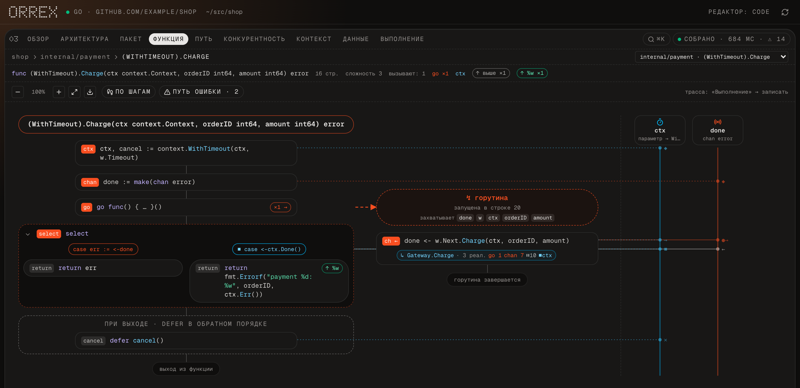
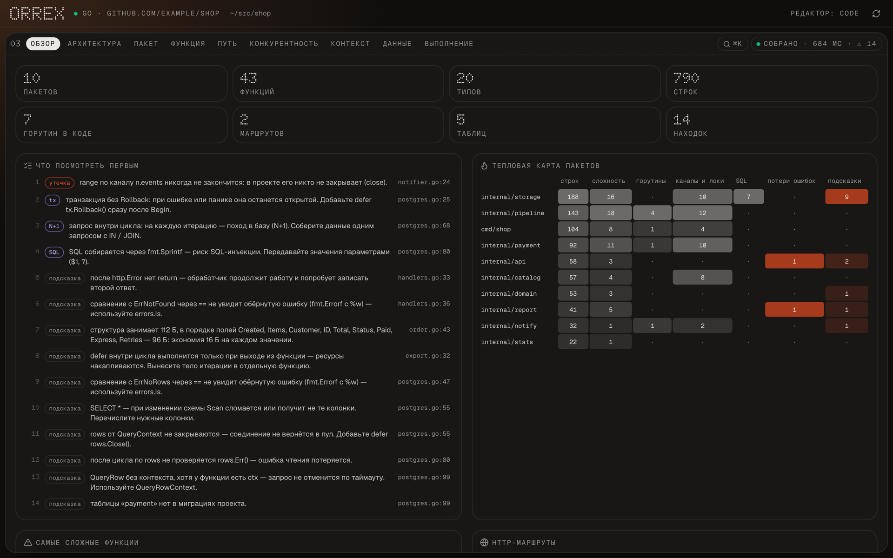
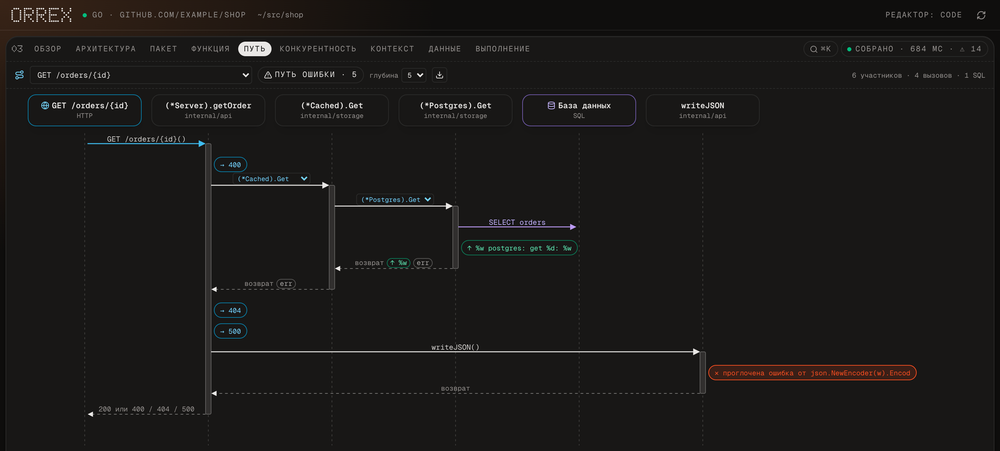
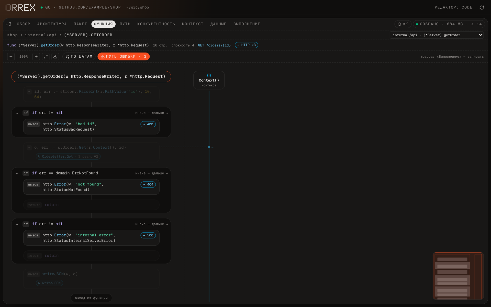
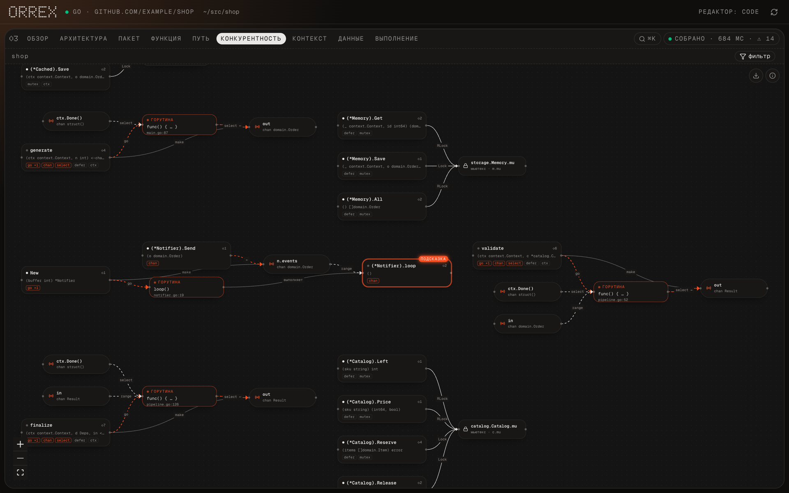
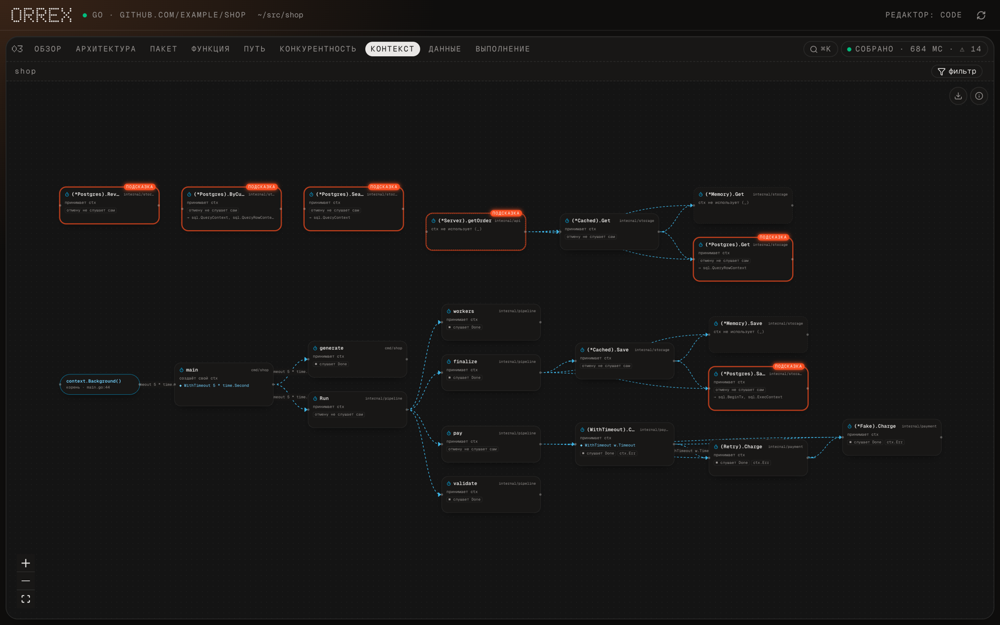

<div align="center">

# orrex

**Увидеть, как на самом деле работает Go-код.**
Одна команда в папке проекта — и в браузере живая карта: блок-схемы с дорожками горутин,
путь запроса от HTTP-маршрута до SQL, где ошибки рождаются и теряются, как течёт `context`
и что горутины делали во время запуска.

[Установка](#установка) · [Что показывает](#что-показывает) · [CI](#в-ci) · [English](README.md)



<sub>Функция с горутиной, каналом, <code>select</code> по <code>ctx.Done()</code> и отложенным <code>cancel()</code>. Клик по любому блоку открывает строку в редакторе.</sub>

</div>

---

```sh
cd ~/my-go-service
orrex            # → http://127.0.0.1:7777
```

Без конфигов, аннотаций и правок в коде. orrex читает исходники через проверку типов Go,
следит за диском и перерисовывает схему при каждом сохранении. Всё остаётся на вашей машине.

## Что показывает

### Обзор — что посмотреть первым
Цифры, тепловая карта пакетов (размер, сложность, горутины, локи, SQL, потерянные ошибки, подсказки)
и находки по важности: сборка → гонки → обрыв `context` → утечки → транзакции и SQL → остальное.
Одинаковые находки одного правила сворачиваются в строку — привычка стиля не заслоняет настоящие баги.



### Путь запроса — от маршрута до базы
Диаграмма последовательности прямо по коду: выберите маршрут (`net/http`, chi, gin, echo — с префиксами групп)
и пройдите вызовы через интерфейсы до SQL. Реализацию интерфейса (`Cached` → `Postgres`) можно переключить
прямо на стрелке. Обёртки ошибок и HTTP-статусы отмечены по пути.



### Путь ошибки
Где ошибка рождается, оборачивается с `%w`, оборачивается **без** `%w` (причина теряется для `errors.Is`),
проглатывается, пишется в лог или превращается в HTTP-ответ. Остальное приглушено.



### Конкурентность
Горутины, каналы и мьютексы всего проекта одним графом: кто отправляет, кто читает, кто закрывает,
кто что захватывает. После записи трассы на мьютексах видно реальное ожидание.



### Контекст
Как `context.Context` идёт от `main` до базы: где создаётся, где подменяется на `context.Background()`
(и отмена перестаёт работать), кто действительно слушает `Done()`.



### Хендлер — сразу видно, что получит клиент
Для HTTP-обработчика рядом со схемой — превью ответа на каждый путь: статус, заголовки и тело.
JSON собирается по литералу или по типу с учётом json-тегов и `omitempty`; свои помощники вроде `writeJSON(w, status, v)`
подставляются в место вызова. Предупреждает, если заголовок выставлен после записи тела, `WriteHeader` вызван дважды
или JSON уходит без `Content-Type`. Поддерживаются `net/http`, gin и echo.

### Вызовы — не уходя со схемы
Клик по вызову функции проекта открывает панель: что функция читает из аргументов и пишет в них, сколько у неё выходов,
defer и горутин, что делает с ошибками — и какие ветки выполнятся при значениях, известных на месте вызова.
Наведение подсвечивает строки, которые готовят аргументы и читают результат. Функцию можно развернуть прямо в узле
вызова или открыть её схему (с хлебными крошками назад). Для stdlib — сигнатура и ссылка на pkg.go.dev.

### Дедлоки и утечки горутин — ещё до запуска
- горутина пишет в небуферизованный канал, а функция может уйти по таймауту или `ctx.Done()` — горутина зависает навсегда;
- канал, который не видит другая горутина, `nil`-канал, `close` в цикле, двойной `close`, отправка после `close`;
- `wg.Wait()` без единого `wg.Done()`;
- функция держит мьютекс и вызывает другую, которая берёт тот же мьютекс; два мьютекса захватываются в разном порядке.

Запишите трассу — и зависший или упавший запуск окажется наверху обзора, со строкой, на которой застрял `main`.

### И ещё
- **Архитектура** — пакеты и импорты; у крупных проектов папки сворачиваются, косвенные импорты скрыты.
- **Пакет** — типы, методы, интерфейсы и их реализации.
- **Данные** — таблицы из миграций (`*.sql`, синтаксис PostgreSQL и MySQL) и функции, которые их читают и пишут; N+1, `SELECT *`, SQL через `fmt.Sprintf`, незакрытые `rows`, транзакции без `Rollback`.
- **Выполнение** — запись трассы горутин (`go test -trace`) и проигрывание поверх блок-схемы; детектор гонок с отметками на графе.
- **⌘K** — переход к любой функции, типу, таблице, маршруту или находке.
- Экспорт схем в PNG (графов — ещё и в SVG).

## Установка

Нужен **Go 1.22 или новее** (проверено на 1.22–1.26). При первом запуске orrex скачивает зависимости движка
и собирает его той же версией Go, что и ваш проект, — около 15–40 секунд, один раз; прогресс виден и в терминале,
и в браузере. Дальше запуск занимает секунду. Если `go.mod` проекта просит Go новее установленного, Go скачает
нужную версию сам — orrex покажет это отдельным шагом.

**macOS — Apple Silicon**
```sh
curl -fsSL https://github.com/Hoobbaaboobba/orrex/releases/latest/download/orrex-aarch64-apple-darwin.tar.gz | tar -xz orrex
sudo mv orrex /usr/local/bin/
```

**macOS — Intel**
```sh
curl -fsSL https://github.com/Hoobbaaboobba/orrex/releases/latest/download/orrex-x86_64-apple-darwin.tar.gz | tar -xz orrex
sudo mv orrex /usr/local/bin/
```

**Linux — x86_64 / arm64** (статический бинарник, любой дистрибутив)
```sh
curl -fsSL https://github.com/Hoobbaaboobba/orrex/releases/latest/download/orrex-$(uname -m | sed 's/arm64/aarch64/')-unknown-linux-musl.tar.gz | tar -xz orrex
sudo mv orrex /usr/local/bin/
```

**Windows 10/11** (PowerShell)
```powershell
$dir = "$env:LOCALAPPDATA\Programs\orrex"
Invoke-WebRequest https://github.com/Hoobbaaboobba/orrex/releases/latest/download/orrex-x86_64-pc-windows-gnu.zip -OutFile "$env:TEMP\orrex.zip"
Expand-Archive "$env:TEMP\orrex.zip" -DestinationPath $dir -Force
[Environment]::SetEnvironmentVariable("Path", [Environment]::GetEnvironmentVariable("Path", "User") + ";$dir", "User")
```
После этого откройте новый терминал. Бинарник пока не подписан: если SmartScreen предупреждает —
«Подробнее → Выполнить в любом случае». Детектору гонок на Windows дополнительно нужен `gcc` (MinGW-w64).

Или скачайте архив со страницы [Releases](https://github.com/Hoobbaaboobba/orrex/releases) и положите `orrex` в любую папку из `PATH`.
Если macOS не открывает бинарник, скачанный браузером: `xattr -d com.apple.quarantine orrex`.

## Запуск

```sh
orrex                          # интерфейс в браузере (http://127.0.0.1:7777)
orrex serve --port 8000 --no-open --editor zed
orrex check                    # без браузера: ошибки сборки и подсказки в терминале
orrex doctor                   # что видит orrex: корень, Go, движок, файлы
```

- Работает в любой папке с `go.mod` — и даже с одним `main.go` без него.
- «В редакторе»: `--editor`, `$ORREX_EDITOR`, `$VISUAL`, `$EDITOR` или первый найденный из
  `cursor`, `code`, `zed`, `goland`, `subl`.
- Трасса и `-race` запускаются на временной копии проекта — ваши файлы не трогаются.
- Сервер слушает только `127.0.0.1`. Никуда ничего не отправляется.

## В CI

```sh
orrex check --format sarif > orrex.sarif     # GitHub code scanning
orrex check --format json                    # итог и находки для скриптов
orrex check --fail-on hint                   # код 1 при любой находке (по умолчанию — только при ошибках сборки)
orrex check --disable error-lost-cause,struct-padding
```

Пример workflow для GitHub Actions — в [английском README](README.md#in-ci).
Коды выхода: `0` — всё в порядке, `1` — есть находки (см. `--fail-on`), `2` — сбой самого orrex.

## Состояние

Ранняя версия, но уже полезна на реальных проектах — проверено на [caddy](https://github.com/caddyserver/caddy):
3,5 тыс. функций разбираются меньше чем за 2 секунды.

- Пока только Go. Сборки под macOS (Apple Silicon, Intel), Linux (x86_64, arm64) и Windows x64.
- Подсказки — эвристики, 34 правила. На коде в другом стиле могут шуметь — выключайте через `--disable`.
- Исходный код пока не опубликован.

Ошибки и идеи — в [Issues](https://github.com/Hoobbaaboobba/orrex/issues).

## Лицензия

MIT — см. [LICENSE](LICENSE). Сторонние компоненты — в [THIRD_PARTY.md](THIRD_PARTY.md).
